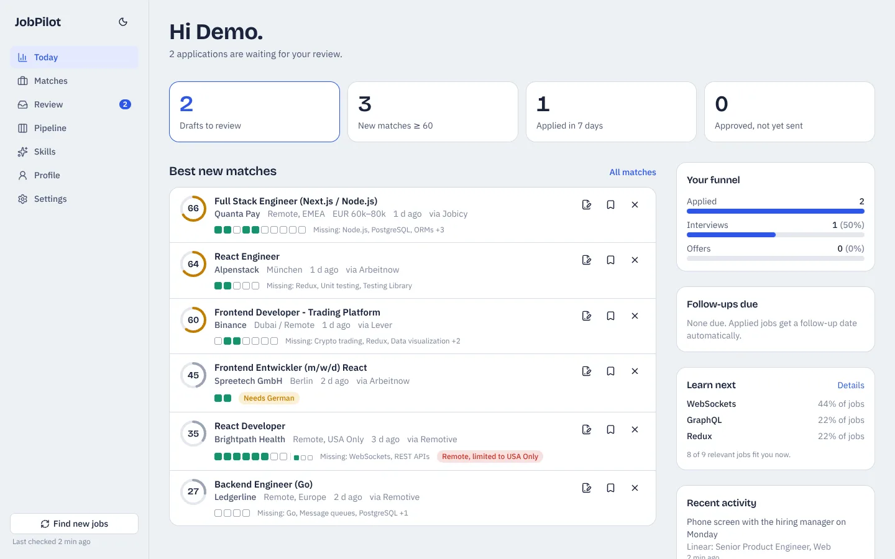
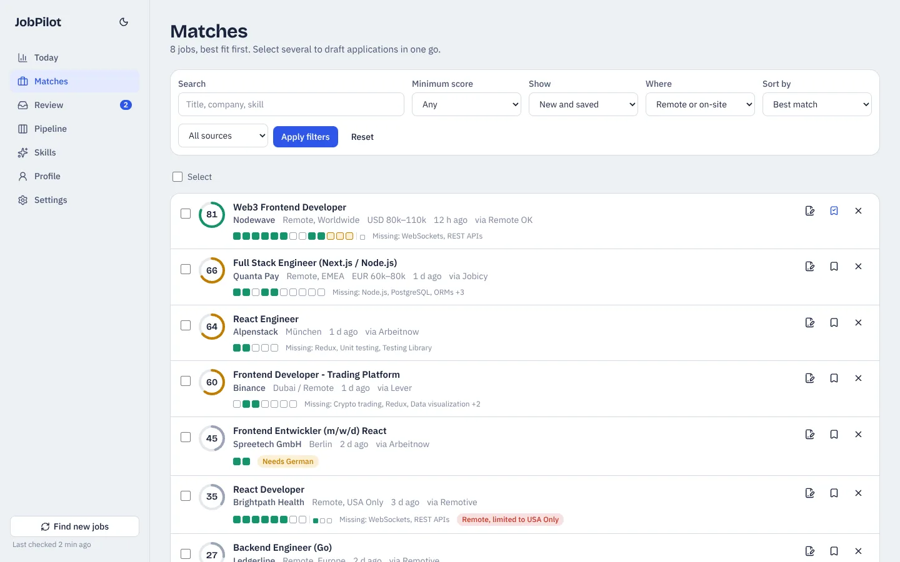
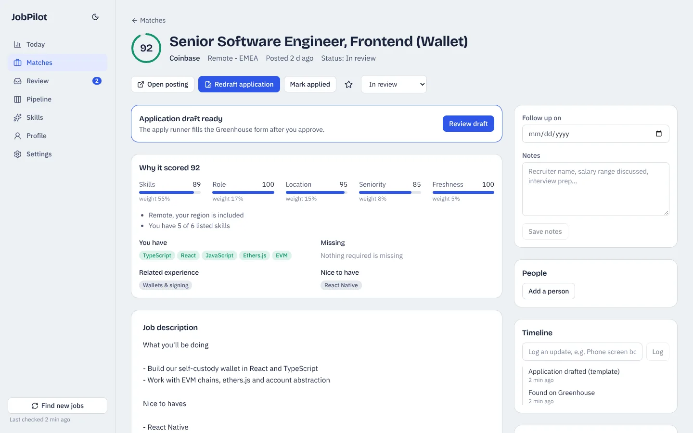
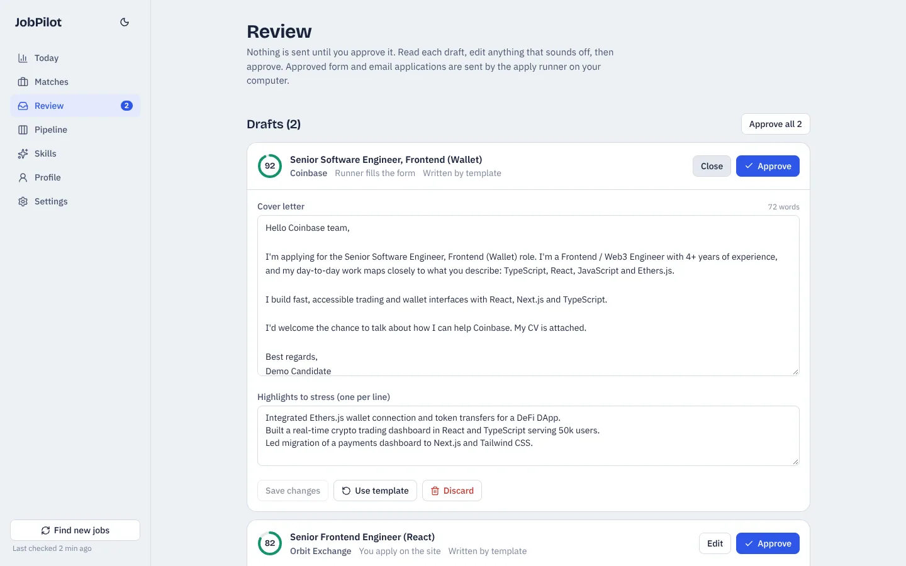
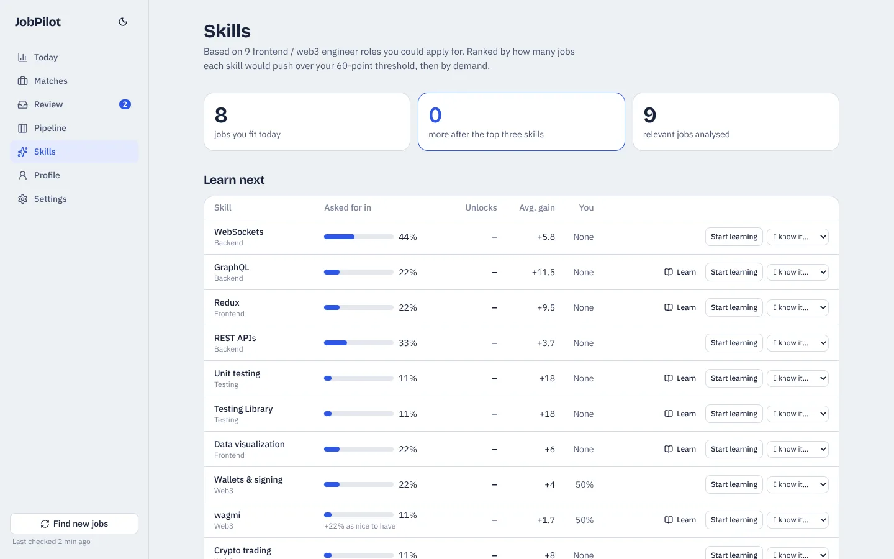
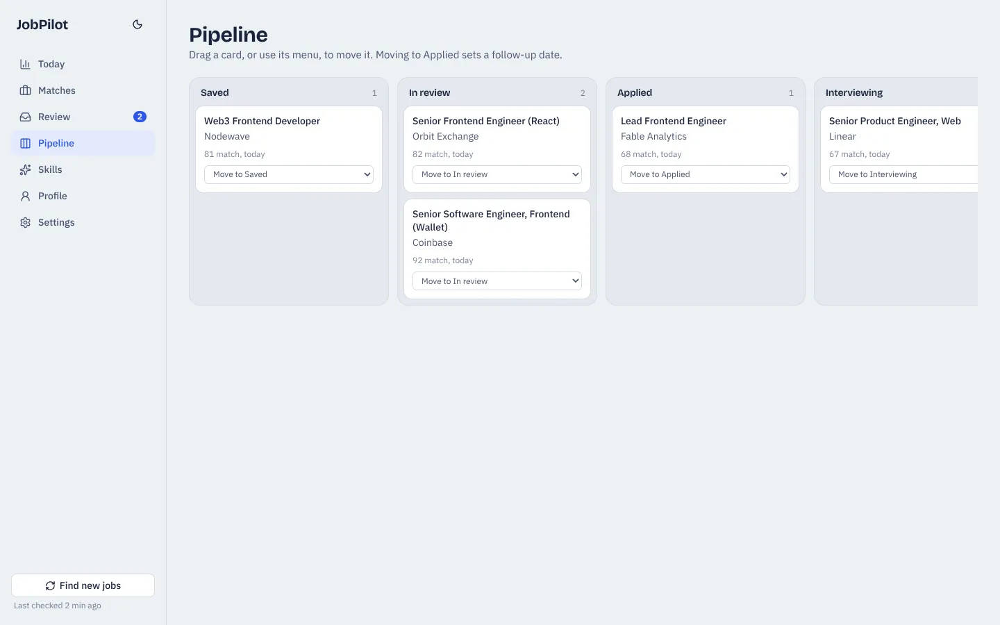

<div align="center">

# JobPilot

**An open-source, self-hosted job search CRM.** It finds jobs that match your skills, drafts tailored cover letters, fills application forms after you approve them, tracks every application in a pipeline, and tells you which skills to learn next to get hired.

[](https://github.com/aun-shahbaz-awan/jobpilot/actions/workflows/ci.yml)
[](LICENSE)




</div>

## Why JobPilot

Job hunting is a funnel, and most tools only cover one part of it. Job boards show you listings, trackers record what you applied to, and AI writers produce generic cover letters. JobPilot connects the whole loop in one app you own:

1. **Find**: pulls fresh listings from free job-board APIs and the career pages of companies you care about.
2. **Match**: scores every job against your real skills, location and seniority, and explains the score.
3. **Apply**: drafts a tailored application, waits for your approval, then fills the form or sends the email for you.
4. **Track**: a CRM pipeline with notes, contacts, timeline and follow-up reminders.
5. **Improve**: works out which missing skills would qualify you for the most jobs, and plans how to learn them.

It runs on your own machine with a local SQLite database, works without any AI, and costs nothing to run. Add an AI key when you want sharper reviews and better-written letters.

## Features

### Job matching that explains itself
Every job gets a 0–100 match score: skills (55%), role (17%), location (15%), seniority (8%) and freshness (5%). Around 120 skills are recognised from the posting and split into required and nice-to-have; related skills earn partial credit (Vue counts a little toward React). It knows whether you can actually apply: remote roles open worldwide or to your country score full, region-locked roles you're outside of are capped, and postings that need a language you don't speak are flagged.





### Application drafts you approve
Select jobs and draft applications in one click. Each draft has a cover letter, the CV highlights that fit the job, and answers to screening questions. Edit anything, then approve. Nothing is sent without your approval.



### An apply runner that fills real forms
`pnpm run apply` opens a real browser and fills Greenhouse, Lever, Ashby and Workable application forms with your details, CV and the approved draft. Email applications go out through your own SMTP account with your CV attached. It never solves CAPTCHAs, never ticks consent boxes for you, and never invents answers: anything it can't fill is left for you to finish.

### Skill-gap analysis
The Skills page re-scores every relevant job as if you had learned each missing skill, then ranks skills by how many jobs they would unlock, their demand and their weekly trend. With AI on, it writes a learning plan with a portfolio project for each skill.



### A pipeline for everything you've applied to
Drag cards from Saved to Applied, Interviewing and Offer. Applying sets a follow-up date automatically.



### Also
- Light and dark themes, keyboard accessible, works on mobile.
- Optional AI with **Claude, OpenAI or Ollama (local, free)**, a model per task, cached results and a monthly budget cap.
- Password lock and a scheduled sync for when you deploy it.

## Job sources

| Source | Coverage | Polling limit respected |
| --- | --- | --- |
| [Remotive](https://remotive.com) | Remote software jobs | Every 6 h |
| [Remote OK](https://remoteok.com) | Remote developer jobs | Every 6 h |
| [Himalayas](https://himalayas.app) | Remote jobs searched with your keywords | Every 12 h |
| [Jobicy](https://jobicy.com) | Remote engineering jobs | Every 4 h |
| [Arbeitnow](https://www.arbeitnow.com) | Germany and Europe, including visa-sponsored roles | Every 4 h |
| Greenhouse, Lever, Ashby | Career pages of companies on your watchlist | Every 3 h |

Listings link back to the original posting as each source's terms require. LinkedIn and Indeed are deliberately not scraped: their terms forbid it and they suspend accounts that automate them.

## Quick start

Requires Node.js 20 or newer and [pnpm](https://pnpm.io).

```bash
git clone https://github.com/aun-shahbaz-awan/jobpilot.git
cd jobpilot
pnpm install
cp .env.example .env    # optional: AI keys, SMTP for email applications
pnpm run setup          # creates the database and a starter profile
pnpm run dev            # http://localhost:3000
```

Then:

1. **Profile**: upload your CV (PDF or DOCX), add your contact details and check your skill levels. Levels drive the match score.
2. Click **Find new jobs**.
3. **Matches**: select good jobs and choose **Draft applications**.
4. **Review**: edit and approve the drafts.
5. Run `pnpm run apply:install` once, then `pnpm run apply` to send what you approved. Try `pnpm run apply --dry` first to watch it fill forms without submitting.

Want to look around without your own data? Run `pnpm run demo`, then `pnpm run dev:demo` (sample jobs on port 3001).

## Tech stack

| Layer | Choice | Why |
| --- | --- | --- |
| Framework | Next.js 16 (App Router, Server Components, Server Actions) | Pages and backend in one TypeScript codebase, no separate API |
| UI | React 19, Tailwind CSS 4, Lucide icons | Fast to build, themable with CSS variables |
| Database | SQLite via libSQL; Turso when hosted | A single local file now, the same code against a free hosted database later |
| ORM | Drizzle ORM and Drizzle Kit | Type-safe SQL and versioned migrations |
| Automation | Playwright | Drives a real browser to fill application forms |
| Email | Nodemailer | Sends email applications through your SMTP account |
| Documents | pdf-parse, Mammoth | Reads text from PDF and Word CVs |
| AI | Anthropic, OpenAI or Ollama over plain HTTP | Switchable per task, no vendor lock-in |
| Tests | Node's built-in test runner with tsx | Unit tests plus a full sync against recorded API responses |

## AI costs

AI is optional. The matcher, templates and skill analysis are free and run offline. With AI on, the defaults use the cheapest capable model:

| Task | Default model | Approximate cost |
| --- | --- | --- |
| Job review (second opinion on fit) | Claude Haiku 5.5 | ~$0.0005 per job |
| Application writing | Claude Haiku 5.5 (Sonnet 5.5 writes better) | ~$0.001 (Sonnet ~$0.02) |
| Learning plan, CV reading | Claude Haiku 5.5 | under a cent |

Responses are cached and a monthly budget cap stops paid calls. Ollama runs models on your own machine for free.

## Deploying (free)

1. Create a free database at [turso.tech](https://turso.tech).
2. Put `DATABASE_URL` and `DATABASE_AUTH_TOKEN` in `.env` and run `pnpm run setup` once to create the tables.
3. Import the repo on [Netlify](https://www.netlify.com) and set `DATABASE_URL`, `DATABASE_AUTH_TOKEN`, `APP_PASSWORD` (locks the site), `CRON_SECRET` and any AI keys.
4. The included scheduled function syncs the most overdue source every 30 minutes, within Netlify's function time limits.
5. Keep running `pnpm run apply` on your computer; with `.env` pointing at Turso it sends what you approve on the hosted site.

## Scripts

| Command | What it does |
| --- | --- |
| `pnpm run dev` | Run the app (creates or updates the database first) |
| `pnpm run setup` | Create tables and a starter profile |
| `pnpm run sync` | Fetch jobs from the terminal (`--force` ignores company-board intervals) |
| `pnpm run apply` | Send approved applications (`--dry` to fill without submitting) |
| `pnpm run apply:install` | Download the browser the runner uses (once) |
| `pnpm test` | Run the test suite |
| `pnpm run demo` / `pnpm run dev:demo` | Explore with sample data on port 3001 |

## Project structure

```
src/app/            pages and server actions
src/components/     UI components
src/lib/sources/    one adapter per job source
src/lib/match/      match scoring
src/lib/skills/     skill dictionary and extraction
src/lib/ai/         provider-agnostic AI client and prompts
src/lib/insights.ts skill-gap analysis
runner/             apply runner (Playwright and email)
tests/              tests and recorded API fixtures
drizzle/            database migrations
```

## Contributing

Issues and pull requests are welcome, especially new job sources, skills for the dictionary, and form-filling support for more applicant tracking systems. See [CONTRIBUTING.md](CONTRIBUTING.md).

## License

[MIT](LICENSE) © Aun Shahbaz Awan
